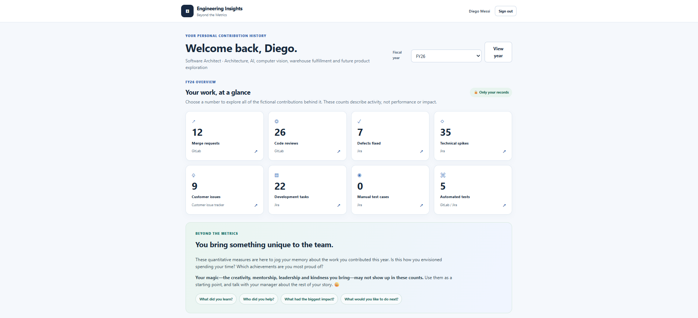

# Engineering Insights — Beyond the Metrics

**An engineering contribution dashboard built to support transparent, human-centered performance and career-development conversations.**

> **Independent portfolio reconstruction.** The professional experience described here reflects an internal dashboard I developed and shared with engineers. This public project uses **fictional employees, synthetic contribution records, and independently developed demo code**. It is not the original employer-owned application or its private integrations, employee records, or data.

## 🎬 Video demonstration

**Engineering Insights — Beyond the Metrics | Engineering Leadership & Employee Development Demo**

[**Watch the Engineering Insights video demo (MP4)**](docs/demo/EngineeringInsights-Beyond-the-Metrics-Demo.mp4)

The recording walks through the dashboard, employee-specific views, fiscal-year contributions, click-through record lists, and the reflection message that motivated the project.

## Application preview

The dashboard below shows **Diego Messi**, a fictional employee, viewing his FY26 contributions. Employees can review only their own records, explore the work behind each activity count, and reflect on the contributions those counts cannot capture.



## Why I built it

Engineering contributions are spread across several systems. During reviews and career-development conversations, it can be difficult for engineers to remember their work across an entire fiscal year—especially investigations, technical spikes, code reviews, and customer support work that may not be highly visible.

I built and shared an internal dashboard to give each engineer **access to their own contribution history** and provide a shared factual starting point for conversations. At the beginning of each fiscal year, I made the relevant view available so employees and I could use quantitative information to help recall accomplishments and discuss growth. The approach covered **FY24–FY27**.

The dashboard was initially shared with my direct reports and was also appreciated by other engineers on the team. This is qualitative feedback, not evidence of measured changes in employee performance or review outcomes.

## Beyond the Metrics — the central principle

> **You bring something unique to the team. Your most meaningful contributions may not appear in these numbers. Use the activity history to jog your memory: What did you accomplish? Was it the year you envisioned? Discuss your leadership, mentoring, collaboration, creativity, and impact with your manager.**

The dashboard was **not an automated performance rating, leaderboard, or productivity score**. Counts can provide evidence of activity, but cannot assess technical complexity, work quality, team impact, or individual circumstances. They were intended to start—and never replace—the human conversation.

## Original data sources and contribution categories

| Source in the original internal workflow | Contribution evidence |
| --- | --- |
| **Jira** | Development tasks, defects, technical spikes |
| **GitLab** | Merge requests, code reviews |
| **Internal customer issue tracking system** | Customer issues investigated, scrubbed, and resolved |

This is a description of the workflow, **not a claim that the public demo connects to any of these systems**.

## What the independent demo shows

The local demonstration uses fictional employees with intentionally different areas of contribution:

| Fictional employee | Focus |
| --- | --- |
| **Diego Messi** | Architecture, AI and computer vision research, warehouse fulfillment, future-product spikes |
| **Allison Dida** | Quality engineering, manual and automated testing |
| **Maria Graf** | UPS and FedEx shipping implementations, defect resolution |
| **Roger Nadal** | AI agents and agentic warehouse workflows |

Each employee can access **only their own** contribution records. The demo includes fiscal-year selection, summary metrics, and clickable totals that open the complete corresponding record list. The public example uses mock records, not live Jira/GitLab links.

### Employee privacy

- Each employee is restricted to their own data; access checks must be enforced server-side, not just through hidden interface controls.
- The demonstration uses fictional identities and synthetic activities only.
- Individual employee rankings and automatic performance scoring are deliberately out of scope.
- The local demo's example sign-in is for illustration, **not production-ready enterprise authentication**.

## Product and engineering choices

1. **Self-service over manager-only analytics:** Give engineers direct access to their own history.
2. **Traceability over arbitrary totals:** Let users click contribution counts and inspect the corresponding tasks, MRs, reviews, and customer issues.
3. **Fiscal-year context:** Support annual reflection across FY24–FY27 rather than presenting disconnected raw totals.
4. **Human judgment over scoring:** Use qualitative discussion to capture leadership, mentorship, cross-team work, technical complexity, and context.
5. **Privacy by design:** Employees see their own records; use fictional data in public demonstrations.

## Run the independent local demo

The application uses **Python 3.10 or later** and only the Python standard library. It binds to `127.0.0.1` and should **not** be exposed to the public internet.

From the repository root:

```powershell
python server.py
```

If Windows has the Python launcher instead, use `py server.py`.

Open **http://127.0.0.1:8765/login** and choose one of the four fictional employees. The local demonstration password is `demo123` (not a production credential).

- Select **FY24**, **FY25**, **FY26**, or illustrative **FY27**.
- Click any metric card to see its full corresponding fictional record list.
- Search records, inspect individual items, and export employee-scoped CSV.
- Sign out and switch fictional employees to compare how their roles produce different kinds of work—not to rank performance.

### Synthetic records

The deterministic [data generator](generate_data.py) generates the fictional contribution set in memory when the application starts; no external APIs, credentials, or internal systems are involved. To also write the generated JSON data locally, run:

```powershell
python generate_data.py
```

The resulting `synthetic_data.json` is ignored by Git because it is reproducible from source.

### Tests

```powershell
python -m unittest discover -s tests -v
```

Tests exercise four-person fiscal-year coverage, metric reconciliation, fictional contribution patterns, authentication redirects, employee record isolation, and owner-restricted CSV exports.

## Repository contents

- [`server.py`](server.py) — local HTTP application, session handling and server-side owner filtering
- [`generate_data.py`](generate_data.py) — deterministic FY24–FY27 synthetic record generator
- [`assets/style.css`](assets/style.css) — responsive dashboard styles
- [`tests/`](tests/) — data integrity and access-control tests
- [Demo video](docs/demo/) — narrated Engineering Insights walkthrough
- [Architecture and access principles](docs/architecture.md)
- [Public portfolio disclaimer](NOTICE.md)

**Scope:** This is an independent local prototype, not the original employer-owned system. The example shared-password login is for a controlled demo and is not production-grade authentication.

## Other engineering leadership projects

- [IssuePilot](https://github.com/yrshenoy/IssuePilot) — AI-assisted issue triage with an independent working POC
- [CarrierMesh](https://github.com/yrshenoy/CarrierMesh) — Provider-neutral ERP shipping integration case study
- [PriceNudge](https://github.com/yrshenoy/PriceNudge) — Post-purchase price monitoring product-design case study

---

*The work described here is presented as a leadership case study. It does not disclose employee performance information, employer source code, proprietary integrations, or actual customer records.*
