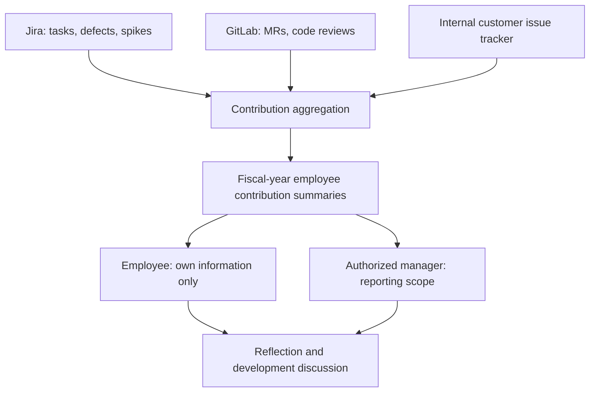

# Engineering Insights — Conceptual architecture and access model

This document describes the original *concept* and the boundaries of an independent portfolio demonstration. It does not expose the original employer's private implementation.

## Original internal workflow (conceptual)

## Public demonstration

The public demo **does not connect** to the three internal systems. Fictional employees and synthetic records reproduce the user experience, not the original source code or proprietary APIs.

### Employee profiles

- **Diego Messi:** architecture, computer vision, AI, warehouse fulfillment, technical spikes, future product research
- **Allison Dida:** manual and automated QA, test strategy, test execution
- **Maria Graf:** UPS and FedEx shipping integration, defects and delivery
- **Roger Nadal:** warehouse AI agents and agentic workflow design

### Functional expectations

1. Sign in as a fictional employee.
2. See only the signed-in employee's FY24–FY27 activity summaries.
3. Select a metric to see **all** synthetic underlying records counted in that metric.
4. Show relevant record identifier, description, state, and date.
5. Keep the reflection message visible and avoid cross-employee ranking.

### Access constraints

- Authorization must be enforced on backend record retrieval, including any JSON/API exports.
- Employee A cannot access employee B's history by editing a URL, query, or record identifier.
- Public examples use only synthetic data.
- Do not publish employer employee records, personal reviews, production credentials, or internal endpoints.
- Demonstration authentication must never be described as suitable for real deployment.

## Interpretation and limitations

Metric totals are **activity indicators**, not direct measures of performance, value, quality, or complexity. Discussions should include mentoring, collaboration, architectural work, risk reduction, and other contributions absent from raw counts. No causal improvement in performance, engagement, or review fairness is asserted without evidence.
